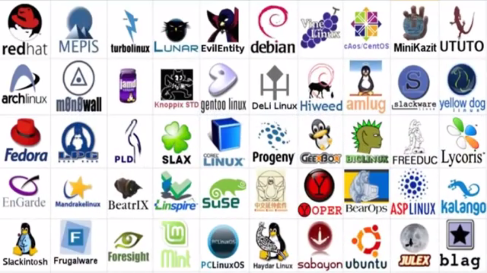
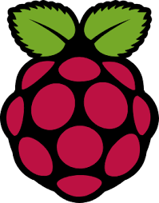
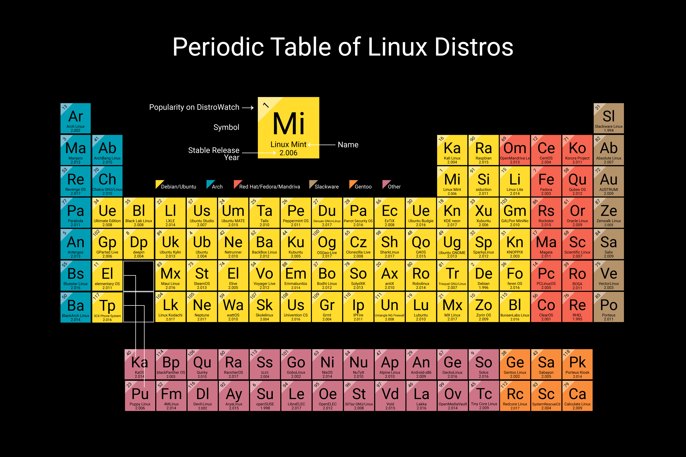
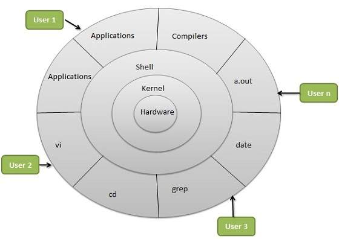
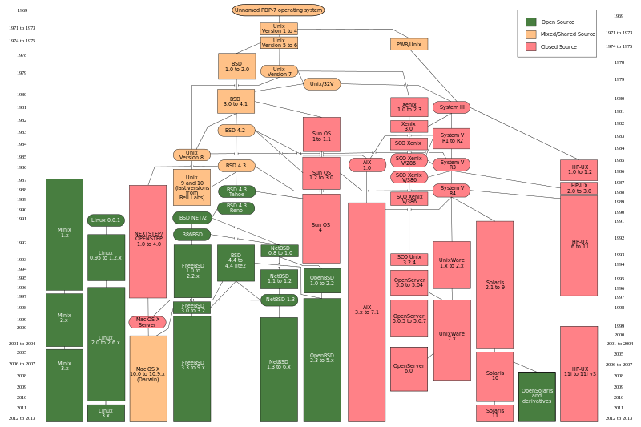

# Linux

# Intro Session 1

__Updated: __  __7__  __ Aug 2026__

# Agenda

*  __What is Linux__ 
*  __Why is Linux __    __difficult__    __ easy__ 
*  __Distro Family Tree__ 
*  __Stretch goals__ 
  * Brave Browser
  * Watch full video link
  * What other reasons to change to Linux

# What is Linux?

---

Open sources and Linux
https://youtu.be/aoag03mSuXQ?si=miyDdApRynMMJ_fN&t=348
https://www.youtube.com/watch?v=g4iKwWtVkw4

# Why People think Linux is Easy & Difficult

* __What makes it easy also makes it difficult\.__
  * __Too many choices__
    * __What Distribution to use? \(Distributions or Distros\)__
    * __Installation type – Network installer\, __  __LiveCD__  __\, __  __LiveUSD__  __\, __  __DualBoot__  __\, Embedded\, Virtual Machine\, Container__
    * __Flavours – e\.g\. Ubuntu; Desktop\, Server\, Cloud\, etc\.__
  * __Size : __
    * __11MB \- Tiny Core Linux – Runs entirely in RAM__
    * __16 GB RAM\, 50GB min storage – Garuda distro for gaming and multimedia\. __
    * __CachyOS__  __ distro for high performance use such as AI\, ML processing__

# Let’s make Linux easy

* __Expect to type some mysterious spells\. __  __It’s OK to not fully understand\.__
* __Expect to Google for solutions\.__
* __It is OK to fail\.__
* __This course is structured to streamline this learning process__
  * __To get you started__
  * __Made all the complicated decisions for you__
  * __Limit the way too many choices to one or two__

# Introduction to Linux Distros

__Welcome to the messy world of Linux__

---

Fasten your seatbelt, Sit back and Relax

__Linux Family Tree__

---

https://distrowatch.com/dwres.php?resource=family-tree

__Popularity contest__

---

https://distrowatch.com/dwres.php?resource=family-tree

# What does your Linux distro say about you?

---

https://www.youtube.com/shorts/ImtoYNt8lFw
https://distrowatch.com/dwres.php?resource=family-tree

# What is in GNU\Linux

__GNU\\Linux is an operating system \(OS\)\. __

__OS is the software on a computer that enables applications \(programs\) to access the devices on the computer to do things\. __

__OS sends instructions from an application to\, for example\, the computer's processor\. The processor performs the job\, then sends the results back to the application via the operating system\.__

__Linux is very similar to other operating systems\, such as Windows and OS X\.__

# Is Linux difficult?

* __Yes and no\. Depends on the person being asked\.__
* __Easy__
  * __Linux is stable and reliable__
  * __Linux is an ideal operating system for power\-users and programmers__
  * __Been and is being developed by power\-users and programmers__
  * __Everything a good programmer can wish for is available: compilers\, libraries\, development and debugging tools__
  * __Highly customisable__
  * __System of choice for old and exotic hardware__
  * __Linux the only operating system in the world that covers a wide range of hardware\.__

# Linux follows the POSIX standard. Full UNIX clone. Easy to switching between UNIX and Linux

# Why is Linux difficult

* __What makes it easy also makes it difficult\.__
* __Most non\-IT professional users have no exposure to Unix\.__
* __Manuals are on every system\, complete and comprehensive; but difficult to find and too technical to read\.__
* __Too many choices__
  * __Distributions__
  * __Installation type – Network installer\, LiveCD\, LiveUSD\, DualBoot\, Embedded\, Virtual__
  * __Flavors – e\.g\. Ubuntu; Desktop\, Server\, Cloud\, Kylin\, Core\, __  _[UbuntuFlavors \- Ubuntu Wiki\.html](file:///G:\Cathy\UbuntuFlavors%20-%20Ubuntu%20Wiki.html)_
  * __Size : __
    * __50 MB – Damn Small Linux \(DSL\) is a little\-lightweight Linux distro based on Debian Linux \. __  __It is very small\, suitable for old computers and single\-board computers\. Run fully in RAM with as little as 128MB\.__
    * __30 GB – Sabayon 3D Desktop is a full “out of the box” bleeding edge distro for gaming and multimedia\. __  __It needs __  __i686\, at least 2\-8 GB RAM\, 3D graphics card\,etc\.__
  * __Shell – sh\, csh\, bash\, ksh__
  * __Text editors \- vi\, vim\, nano\, emacs__
  * __Reading file \- cat\, more\, less\, head\, tail__
  * __Desktop environment \- GUI windows\-like environment \- \(Unity\, GNOME\, Cinnamon\, Enlightenment\, KDE\, XFCE\, etc\) __
  * __Applications – More than 10 browsers\, including Lynx \(text based browser\)__

# Ubuntu Desktop – First look

* __Boot up__
* __Login__
* __Navigate around Unity__
  * __Side bar__
  * __Disk and mounts__
  * __Top bar__
  * __Window handling__
* __Setup Wifi__
* __CLI terminal__
